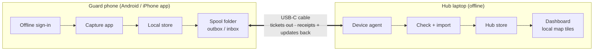
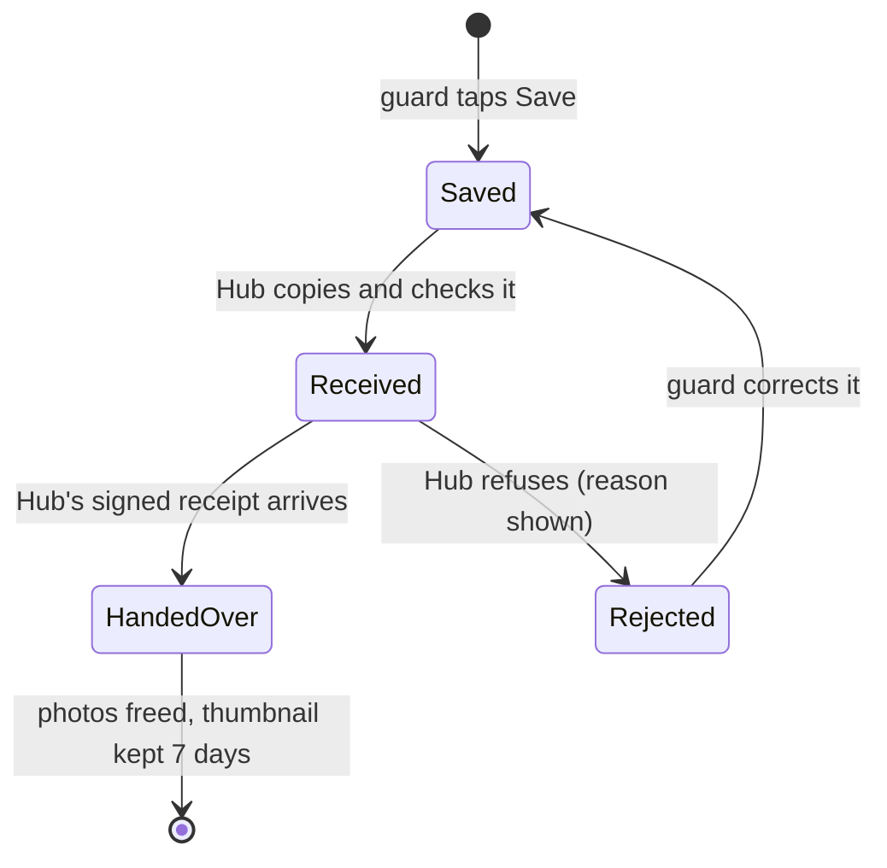
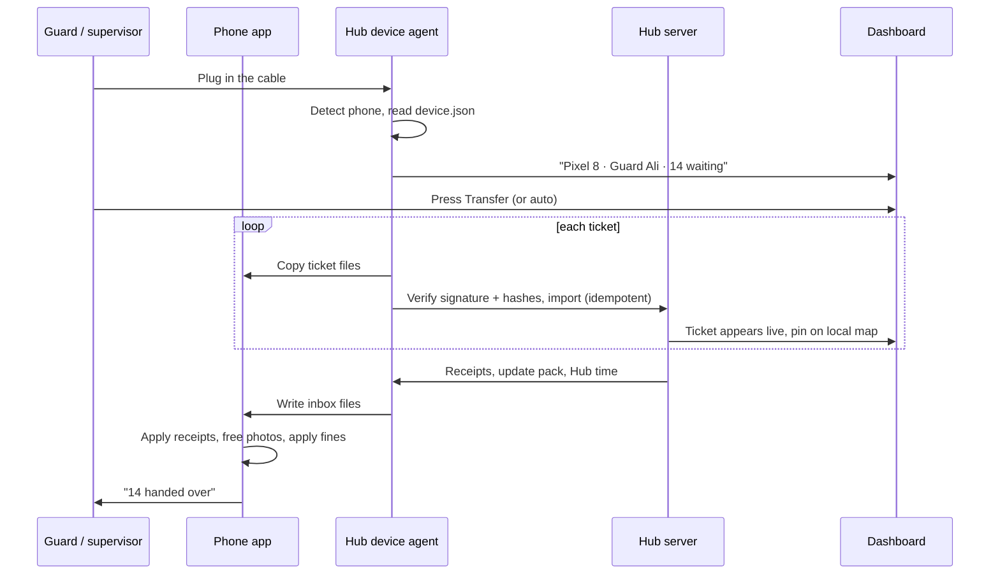

# Park Patrol — offline, cable-only architecture

Plan for the Ministry requirement: **no Wi-Fi on campus, data moves by cable only.**
Written 2026-11-18. This is the production design. **The demo build** (also 2026-11-18) uses a simpler carrier that needs no native app: each ticket is saved as a picture with its data in a QR code, and the laptop reads it from the phone's Photos / Download folder over the cable — see `DEMO-CABLE.md`.

---

## 1. The requirement, and what it really means

- The campus has no Wi-Fi and no internet. The whole system runs offline.
- A **Hub** (a laptop or PC — Windows, macOS or Linux) runs the dashboard and stores the tickets.
- A guard's phone (Android or iPhone) connects to the Hub **only by USB-C cable**. On connect, the tickets transfer, with buttons on the Hub (and the phone) to control it.
- The app must be installable on both Android and iPhone.

Three consequences drive every decision below:

1. **The phone becomes the system of record.** Today the phone is a short buffer: tickets leave within seconds of getting a connection. Now a ticket may sit on the phone for a whole shift or several days. Durability and loss-protection become first-class requirements.
2. **Every network assumption in today's app must be replaced** (section 2).
3. **A phone's browser cannot talk over a cable.** Neither Android Chrome nor iPhone Safari exposes USB networking to a web page. On iPhone this means a *native* app is unavoidable; on Android a native app is the only route that does not require developer settings.

---

## 2. What breaks in today's design

| Today | Why it needs a network | Offline replacement |
|---|---|---|
| PWA installed from an `https://` URL | iOS and Android only install a PWA from a trusted HTTPS origin | Native shell (Capacitor) installed from an APK / IPA; all assets bundled in the app |
| Upload: `POST /api/violations` ([server/index.js:189](server/index.js)) | Wi-Fi or internet | Tickets written as files to a **spool folder** and carried over the cable |
| Guard sign-in must reach the server once ([offlineAuth.ts](src/guard/offline/offlineAuth.ts)) | The password is only checked on the server | The **Hub enrols the phone** and writes each guard's password *verifier* to it (same PBKDF2 format the app already verifies) |
| Bearer tokens for uploads | Issued by `/api/auth/login` | Replaced by a **device key**: each phone signs its tickets; the Hub knows the phone's public key |
| Socket.IO live link, live guard positions | A network path to the server | "Last handover" status per phone; GPS recorded per ticket |
| Field pack: fines, watchlist, status of my tickets ([sync.ts](src/guard/offline/sync.ts) `refreshFieldPack`) | `GET /api/intel/field` | An **update pack** pushed to the phone at every cable connection |
| Dashboard map tiles from openstreetmap.org ([parts.tsx:166](src/console/parts.tsx)) | Internet | **Local map tile pack** (PMTiles) served by the Hub |
| LLM plate check / advisory brief ([server/lib/llm.js](server/lib/llm.js)) | Hosted model APIs | Deterministic engine stays on; LLM is optional via local Ollama, or off |
| Phone-clock correction using `sentAt` | Measured at upload | Measured at **handover** (Hub's time vs phone's time) |

**Already works offline** and is reused unchanged: camera, GPS, the plate reader (Tesseract WASM bundled in `public/ocr`), fonts, ticket capture, Bluetooth printing, the fine schedule.

---

## 3. Architecture



### Design principles

1. **Store-and-forward.** At the moment the guard taps Save, the app writes the ticket twice: into its database *and* as a signed, self-contained file group in the spool folder. The files are the thing the cable carries — and a second copy if the app database is ever lost.
2. **Carrier-agnostic handover.** The cable, a drag-and-drop, or a USB flash drive are all just *carriers* of the same spool files. The Hub imports the same files whichever carrier brought them (section 5).
3. **Delete only on receipt.** The phone frees a ticket's photos only after it sees the Hub's signed receipt containing that ticket's hash. A Hub crash or a pulled cable can never cost a ticket.
4. **Idempotent by ticket id.** Already true today (the phone makes the UUID, the server returns the stored record on repeats). Re-importing the same ticket is harmless.
5. **The Hub is the only server.** Dashboard, store and import all run locally. Nothing calls out.

### Components

**Phone app** (the existing React code in a Capacitor shell)
- Reused: capture flow, plate scanner, printing, offline sign-in screens, local database.
- Replaced: `sync.ts` (network engine) → `handover.ts` (spool writer + inbox reader). No tokens, no socket, no `auth` state.
- New: spool folder, device key, "Hand over" screen, receipt viewer.

**Hub**
- *Hub server* — the existing Express + `store.js` + Socket.IO. Socket.IO now only links the server to the dashboard window on the same machine. Gains: serve the built dashboard itself, a device registry, a handover log, and an `ingestViolation()` function (extracted from the `POST /api/violations` handler so validation is shared).
- *Device agent* (new) — watches for phones, copies files to and from them, per carrier. Tells the dashboard when a phone appears.
- *Hub shell* (production) — Electron wrapper: tray icon, single instance, start-on-login, a pop-up when a phone is plugged in. For the demo, a launcher script that opens the browser is enough.

---

## 4. The handover protocol

### Spool folder layout (on the phone)

```
ParkPatrol/
  outbox/
    device.json                 device id, label, public key, app version  (written once)
    tickets/<ticketId>/
      ticket.json               the record (same fields the app uploads today)
      vehicle.jpg  plate.jpg    evidence photos (~200–350 KB each)
      manifest.json             sha256 of each file + device signature
    ops/<opId>.json             printed notice, mistake report (what `Op` is today)
  inbox/
    hub.json                    Hub id + public key (written at enrolment)
    receipts/<handoverId>.json  per-ticket result, signed by the Hub
    pack.json                   fines, watchlist, hotspots, status of my tickets, roster changes, Hub time
    app/ParkPatrol.apk          optional app update (Android)
```

A ticket is ~0.5–0.7 MB with both photos, so 100 tickets ≈ 60 MB — seconds over USB 2.0. Transfer speed is not a concern; reliability is.

### Ticket life cycle



`HandedOver` replaces today's `synced`. The `auth` state disappears (no tokens).

### Security

- **Device key.** Each phone creates a key pair on first launch; the private key never leaves it. Every ticket manifest is signed with it.
- **Pairing.** At enrolment the Hub and phone each display the same short code (e.g. `482 913`). The supervisor confirms they match — this stops a rogue laptop from enrolling a phone or a rogue phone from enrolling with the Hub.
- **Hub identity is pinned.** After enrolment the phone only accepts receipts and packs signed by *its* Hub. A stranger's laptop that gets USB access cannot feed the phone fake fines.
- **Consent on the phone.** First connection to an unrecognised computer needs an **Allow transfer** tap; an enrolled Hub can be set to auto-allow.
- **Verification on the Hub.** Unknown device → refused ("Enrol this phone first"). Hash mismatch → refused with the reason. Everything lands in the existing hash-chained audit log, plus a `handover` entry (device, guard, counts, bytes, carrier).
- **Lost-phone protection (production).** Spool files encrypted to the Hub's public key, so the files sitting on a lost phone are unreadable without the Hub.

### Time

Offline phones drift. At each handover the Hub writes its time to the pack and records the phone's difference. The existing rule (correct capture times when the error exceeds 2 minutes, `CLOCK_SKEW_LIMIT`) stays, but the error is now measured at *handover*, so it can be larger than today's. A phone with a SIM gets network time; without one, treat the device clock as untrusted and show the measured offset on the Hub. A later improvement is stamping tickets with GPS satellite time.

### Edge cases

| Situation | Behaviour |
|---|---|
| Cable pulled mid-transfer | Tickets without a receipt stay on the phone; replug resumes; no duplicates |
| Same ticket arrives twice (cable + flash drive) | Second import returns "duplicate", receipt still issued |
| Hub disk nearly full | Hub checks free space before import and refuses with a clear message |
| Phone storage full | Phone warns when the outbox exceeds a threshold; Hub shows it on the phone card |
| Phone replaced mid-shift | Tickets stay on the old phone; dock it before returning it |
| App update changes the format | `manifest.json` carries a schema version; Hub accepts the current and previous version |

---

## 5. The cable: carriers

No single zero-setup USB method works on every phone × desktop combination. That is a platform fact, not a design flaw — so the protocol (section 4) is independent of the carrier and we pick the best carrier per platform.

| Carrier | Phone setting needed | Hub needs | Verdict |
|---|---|---|---|
| **Android + adb** | Developer options → USB debugging, approve the computer once | `adb` binary (shipped inside the Hub) | **Primary for Android.** Works on Windows/macOS/Linux. Needs debugging enabled — a Ministry policy question |
| **iPhone + Apple file service (AFC)** | Tap **Trust** once; app has File Sharing enabled | `libimobiledevice` or `pymobiledevice3`; on **Windows** also Apple's USB driver (iTunes or the Apple Devices app) | **Primary for iPhone.** Simplest on a macOS Hub; Windows needs the Apple driver installed first |
| Android + MTP ("File transfer") | None — default USB mode | Windows can script it; macOS/Linux need extra tools | Semi-manual fallback; no debugging needed |
| Drag-and-drop | None | A drop zone in the Hub window | **Universal fallback.** Guard copies `ParkPatrol/outbox` to the Hub |
| USB flash drive | Phone exports to a drive (OTG on Android, USB-C on iPhone 15+) | A folder watcher | **Universal fallback** and a good fit for strict air-gap rules |
| Android USB tethering | Toggle USB tethering | Discover the new network adapter | Possible without debugging, but drivers and vendor behaviour vary (RNDIS vs NCM) — test per phone model before trusting |
| iPhone Personal Hotspot over USB | Needs cellular plan | — | **Rejected.** Not available on phones without a plan/SIM |
| USB-C → Ethernet dongle | Dongle on the phone; iPhone 15+ or Android with OTG | Wired NIC | Spike only. Extra hardware per phone |

**Recommendation:** adb for Android, Apple file service for iPhone, drag-and-drop and flash drive as always-available fallbacks. All four feed one importer.

---

## 6. Installing the app on the phones

The install is a **one-time provisioning step done where internet exists** (our office), not on campus. After that the phones never need the internet again — except where noted.

### Android

| Method | Use | Notes |
|---|---|---|
| `adb install` over the cable | Demo and small fleets | The Hub gets an **Install / update app** button (it already bundles `adb`). Re-uses the Capacitor Android project already in `other_project/android` |
| Copy the APK, tap to install | Fallback | Needs "Install unknown apps" allowed for the file manager |
| MDM / managed Google Play | Larger fleets | Done at provisioning time, not on campus |

Android's new developer-verification rule: as reported in October 2026, enforcement began 30 Sep 2026 only in Brazil, Indonesia, Singapore and Thailand, with a global rollout planned for 2027, and installs through `adb` stay exempt. **Re-check before the Ministry rollout** and register the app's package name so it is ready.

### iPhone

A native app is required, so this needs things the project does not have today:

- An **Apple Developer Program** membership and signing certificates.
- A **Mac with Xcode, or a cloud Mac build** (the repo is on GitHub, so a macOS build runner is an option). Building an IPA from Windows alone is not possible.

| Method | Fit | Notes |
|---|---|---|
| **Ad Hoc** (register each phone's UDID) | Demo and pilot (≤100 devices/yr) | Install over the cable with Apple Configurator or Finder; works without internet on campus |
| **TestFlight** | Demo | Needs internet to install and update; builds expire after 90 days |
| **Apple Business Manager custom app + MDM** | Production | Needs the Ministry's MDM and IT |
| Apple Enterprise Program | — | Apple restricts it to narrow internal use; not a plan A |
| Free personal-team sideload | Throwaway demo only | Expires after 7 days (general knowledge, not checked in this research) |

**Why not just keep the PWA?** An iPhone PWA can only be installed from a trusted HTTPS site, and a web page can never use the cable. It cannot satisfy this requirement.

---

## 7. Workflows

### 7.1 Provision a phone (once)

1. Install the app (section 6).
2. Plug into the Hub. Hub shows **New phone** with a pairing code; the phone shows the same code.
3. Supervisor confirms the match and presses **Enrol**.
4. Hub writes the Hub identity, the guards' password verifiers, the fine schedule and areas to `inbox/`. The phone applies them and shows **Enrolled with Hub 01**.

### 7.2 A guard's shift (phone alone, no cable)

1. Sign in offline using the roster from enrolment.
2. Capture tickets as today: photo, plate (auto-read), type, GPS, area, notes; print the notice over Bluetooth.
3. Each save writes the database record **and** the signed spool files. The home screen shows **N waiting for Hub** (replacing today's online/offline badge).

### 7.3 Dock the phone



### 7.4 The buttons

**Hub — Handover panel.** It opens from the **Field Team** page and as a pop-up when a phone is plugged in. It is *not* a fifth sidebar page, keeping the dashboard at its four pages.

| Where | Control | Does |
|---|---|---|
| Phone card | Model, platform, guard, battery, app version, last handover, **N waiting · MB**, clock difference | Shown the moment the cable connects |
| Phone card | **Transfer tickets** | Imports every waiting ticket and notice |
| Phone card | **Send updates** | Pushes fines, watchlist, hotspots, ticket statuses, roster changes |
| Phone card | **Sync clock** | Writes Hub time; records the offset |
| Phone card | **Install / update app** (Android) | `adb install` of the bundled APK |
| Phone card | **Enrol this phone** | Pairing flow (7.1), for unknown phones |
| Phone card | **Done — safe to unplug** | Shows the final receipt count |
| Panel | **Auto-transfer when plugged in** (toggle) | One-click-free docking at shift end |
| Panel | **Import from folder / flash drive…** and a drop zone | The fallback carriers |
| Panel | **Handover history** | Per handover: phone, guard, imported / duplicate / rejected, bytes, time |

**Phone — Hand over screen.**
- Cable status; **Connected to "Hub 01" ✓ verified**; **14 waiting**.
- **Allow transfer** (first time, or any unrecognised computer).
- Progress while the Hub copies; then **14 handed over** with a receipt.
- **Export to USB drive / share file** for the fallback carriers.

### 7.5 Demo script

1. Hub laptop with Wi-Fi switched off, phone in airplane mode — visible proof it is offline.
2. Guard signs in; records 3 violations (one with a printed notice).
3. Plug in. Hub pops up **Pixel 8 · 3 waiting** → **Transfer** → progress → rows land on the dashboard with pins on the local map.
4. Phone shows **3 handed over**.
5. Change a fine on the Hub → **Send updates** → the phone's fine schedule changes.
6. Resilience: start a transfer, pull the cable, replug — it resumes, no duplicates.

---

## 8. The Hub in detail

- **Packaging.** Demo: a folder with a portable Node runtime, the server, the built dashboard and `adb`, started by a launcher. Production: signed Electron installers for Windows, macOS and Linux (macOS signing needs a Mac or cloud build).
- **Offline assets.** Map tiles as a PMTiles extract for Abu Dhabi (size depends on zoom; city-level zoom is typically tens to low hundreds of MB — measure in the spike), with bundled fonts and a style; OCR and fonts are already local. Do not bulk-download openstreetmap.org tiles — its policy discourages it; use an open-data extract.
- **Data store.** The JSON store is fine for the demo. For production move to SQLite and add a nightly encrypted backup to a USB drive.
- **Desk PCs.** The dashboard needs no camera, GPS or service worker, so it needs no HTTPS. If the Ministry wants other desks to view it, the Hub can bind to a **wired** LAN over plain HTTP — still no Wi-Fi.
- **AI.** The deterministic advisory engine stays on. An LLM is optional: local Ollama on the Hub (already a supported provider in `llm.js`), or off.
- **Prerequisites on the Hub PC:** Google USB driver for some Android phones; Apple's USB driver on Windows for iPhone; security software and admin rights that allow `adb` and the device agent to run.

---

## 9. Code impact

| Area | Change |
|---|---|
| [src/guard/offline/sync.ts](src/guard/offline/sync.ts) | Replace with `handover.ts`: write spool on save, read `inbox/` on resume and every few seconds. Keep the state machine and UI badges |
| [src/guard/offline/db.ts](src/guard/offline/db.ts) | Keep for the demo (spool files are the safety copy). Production: move to native SQLite |
| [src/guard/offline/offlineAuth.ts](src/guard/offline/offlineAuth.ts) | Credentials come from the enrolment pack; drop tokens |
| [server/index.js](server/index.js) | Extract `ingestViolation()`; static-serve the dashboard; add device registry, handover log, importer endpoints |
| [server/lib/store.js](server/lib/store.js) | Add `devices`, `handovers`, receipts; audit entries |
| [src/console/parts.tsx](src/console/parts.tsx) (map) | Swap the OSM tile layer for the PMTiles source |
| [src/console/TeamPage.tsx](src/console/TeamPage.tsx) | Host the Handover panel |
| [vite.config.ts](vite.config.ts) | PWA kept for browser use; the native build skips the service worker |
| New | Capacitor config + `ios/` + reuse `other_project/android`; spool plugin glue; `hub/` device agent and carriers |

---

## 10. Phases

Estimates are rough and should be re-set after the spikes in section 11.

| Phase | Goal | Delivers | Rough effort |
|---|---|---|---|
| **0 — Android quick demo** | Cable-triggered transfer visible in days | Hub serves the built app on `:4357`; `adb reverse` makes `localhost:4357` on the phone point at the Hub, so the **existing sync engine runs unchanged** when the cable is in and the PWA still opens from cache when it is out. Handover panel with device detection, **Install app**, **Transfer** | 2–3 days |
| **1 — Real design on Android** | The architecture above, Android only | Capacitor APK, spool + signed tickets + receipts, enrolment, Handover panel, local tiles, drag-drop and flash-drive import | 8–10 working days |
| **2 — iPhone** | Same on iPhone | Capacitor iOS app, File Sharing, Apple-service carrier, signing + Ad Hoc/TestFlight pipeline | 6–8 working days **after** the Apple account and a Mac/cloud build exist |
| **3 — Production hardening** | Ministry-ready | Electron installers, SQLite + backups, encrypted spool, MDM install, audit review, Android without debugging | 2–3 weeks |

Phase 0 looks identical on stage to the final product (plug in → tickets flow) but is a stepping stone: it needs USB debugging, is Android-only, and keeps the phone's data only in the browser database. Phases 1–2 fix all three.

---

## 11. Risks — spikes to do first (about a day each)

1. **Android file access.** Confirm the spool folder is readable over `adb pull` and MTP on Android 13–15 with scoped storage; choose app-private external folder vs a public `Documents` folder.
2. **Phase 0 viability.** `adb reverse` + Chrome installing a PWA from `http://localhost:4357`: confirm install, camera, GPS and offline reopen.
3. **iPhone file service from Windows.** Capacitor iOS app with File Sharing; read and write its Documents from a Windows Hub using `libimobiledevice` / `pymobiledevice3` with Apple's driver; repeat on macOS and on the iOS version the Ministry uses. Public docs confirm the `house_arrest` + AFC mechanism, but one reported failure to start the service on Linux shows it must be tested.
4. **Apple signing.** Developer account, UDID registration, a Mac or cloud runner.
5. **Map tiles.** Size and rendering of an Abu Dhabi PMTiles pack with the Leaflet plugin.
6. **Android USB tethering** on the actual handset models (RNDIS vs NCM) — only if debugging is not allowed.
7. **Locked-down Hub PC.** Antivirus and admin-rights behaviour with `adb` and the agent.
8. **Phone clocks.** How far real handsets drift with no SIM and no network.

---

## 12. Decisions needed

1. **Is USB debugging acceptable on the guard Android phones?** If not, the primary Android carrier changes to MTP / drag-drop / tethering.
2. **iPhone: in the demo, or production only?** It needs an Apple Developer account and a Mac or cloud build. If the demo can be Android-only, iPhone moves to Phase 2.
3. **Demo date, Hub operating system, and who runs it.**
4. **Is a private, laptop-created Wi-Fi network (no campus infrastructure) allowed?** It would collapse most of this design into today's sync over HTTP. "No Wi-Fi on campus" almost certainly rules it out, but it is worth one question.
5. **Scale:** phones, guards, tickets per day, and whether all guards dock at once at shift end (a USB hub with several phones works, but the Hub must handle them in parallel).
6. **Evidence rules:** how many days a ticket may stay on a phone, whether the spool must be encrypted, retention and backup expectations.
7. **Hub PC:** managed by Ministry IT or by us? Admin rights for drivers?

---

## Sources checked for this plan

- Android developer verification timeline and `adb` exemption: [Android Authority timeline](https://www.androidauthority.com/android-sideloading-changes-timeline-3679204/), [Google's support page](https://support.google.com/android-developer-console/answer/16561738). Reported through early October 2026; confirm current status.
- iOS app-folder access over USB: [libimobiledevice `house_arrest`](https://docs.libimobiledevice.org/libimobiledevice/latest/house__arrest_8h.html) and [`afc`](https://docs.libimobiledevice.org/libimobiledevice/latest/afc_8h.html).
- iOS distribution limits (Ad Hoc, TestFlight, Business Manager custom apps, Enterprise): [Foresight Mobile 2026 guide](https://foresightmobile.com/blog/ios-app-distribution-guide-2026), [Apple Enterprise Program](https://developer.apple.com/programs/enterprise/how-it-works). Sources disagree on whether the 100-device Ad Hoc cap is per device type or per account.
- Android USB tethering behaviour (RNDIS vs NCM): only community sources found — treated as unverified.
